<div align="center">


# Lume

**Diz o que gastaste. O resto é connosco.**

Finanças pessoais para iOS — regista uma despesa numa frase, por voz ou com uma fotografia do talão, e a app diz-te quanto podes gastar hoje.

[](https://swift.org)
[](https://developer.apple.com/ios/)
[](https://developer.apple.com/xcode/swiftui/)
[](https://developer.apple.com/xcode/swiftdata/)
[](#testes)
[](#arquitetura)

</div>

<br>

<p align="center">
  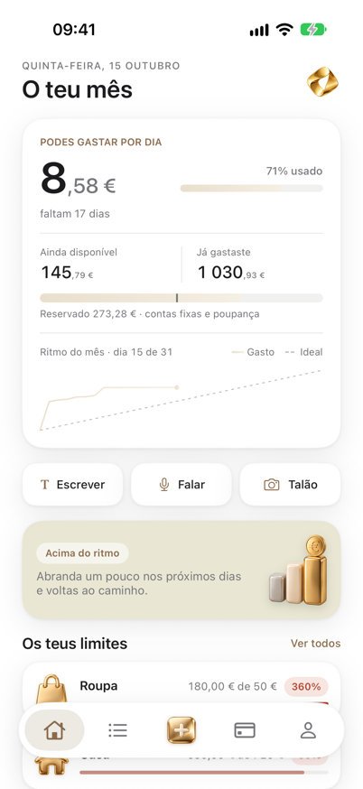
  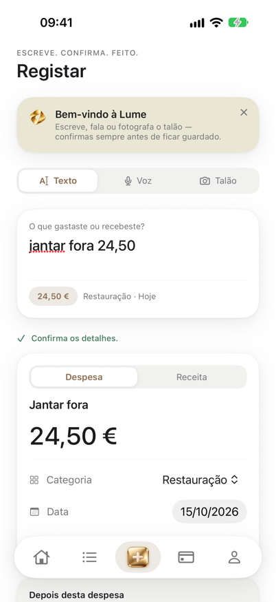
  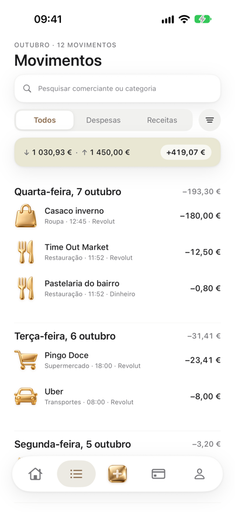
  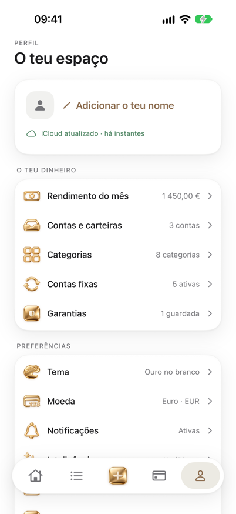
</p>

---

> **A app faz as contas, a IA só interpreta.** Nenhum modelo de linguagem calcula totais, saldos ou o número diário — isso é sempre Swift determinístico e testado. A IA só transforma texto livre em dados estruturados, e nada é gravado sem confirmação.

Feita com Swift 6, SwiftUI, SwiftData e Foundation Models. **Sem servidores, sem analytics, sem dependências externas** — os dados ficam no iPhone e sincronizam só através do iCloud da própria pessoa.

## Índice

- [Registar uma despesa](#registar-uma-despesa)
- [Perceber o mês](#perceber-o-mês)
- [Planear](#planear)
- [Garantias e talões](#garantias-e-talões)
- [Privacidade e bloqueio](#privacidade-e-bloqueio)
- [Em todo o lado](#em-todo-o-lado)
- [Arquitetura](#arquitetura)
- [Testes](#testes)
- [Correr o projeto](#correr-o-projeto)

---

## Registar uma despesa

Três formas de dizer o que gastaste, todas a terminar no mesmo cartão de confirmação — nada é gravado sem se rever primeiro.

<p align="center">
  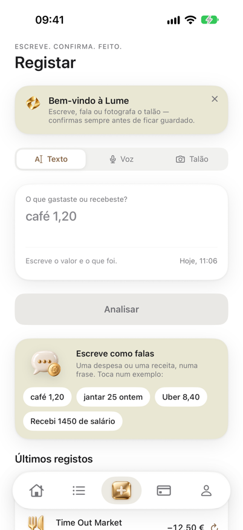
  
  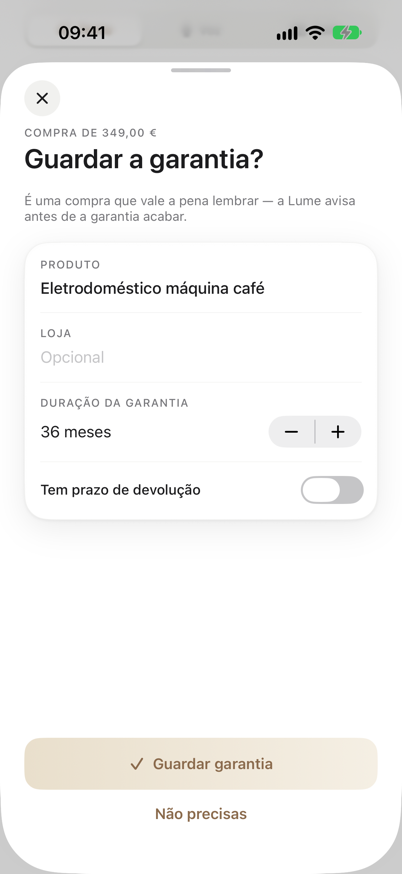
</p>

- **Texto** — "jantar fora 24,50", "uber 8€ ontem", "café 80 cêntimos". Valor, loja, categoria e data saem de uma frase só.
- **Voz** — reconhecimento de fala em pt-PT, no dispositivo sempre que possível.
- **Talão** — a câmara ou a galeria leem a loja, o total e a data com o Vision.
- **Apple Pay automático** — uma automação dos Atalhos regista o pagamento sozinha, sem abrir a app.
- **Siri e Atalhos** — "Ei Siri, regista uma despesa" ou o Botão de Ação.
- Numa compra grande, a Lume sugere logo guardar a garantia.

## Perceber o mês

<p align="center">
  
  
  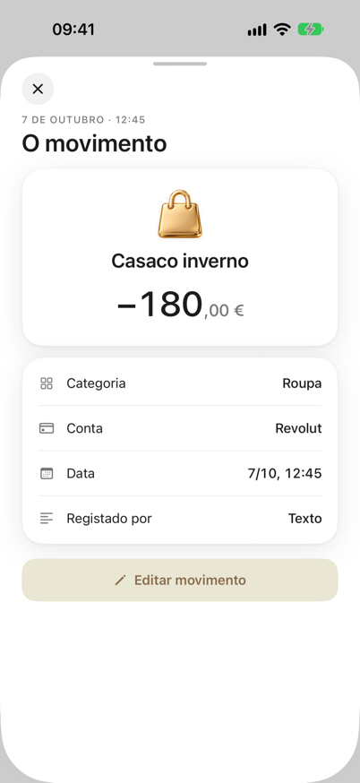
</p>

- **Resumo** — quanto podes gastar hoje, quanto já gastaste e quanto falta até ao fim do mês.
- **Ritmo do mês** — o gasto acumulado contra uma referência linear, num gráfico simples.
- **Movimentos** — lista agrupada por dia, com pesquisa, filtros, edição e apagar por gesto.
- **Fecho do mês** — um resumo em formato de histórias, no estilo "wrapped", com o total, a categoria principal, o dia mais caro e a comparação com o mês anterior.

<p align="center">
  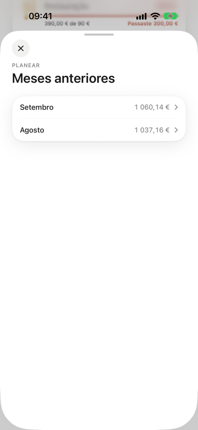
  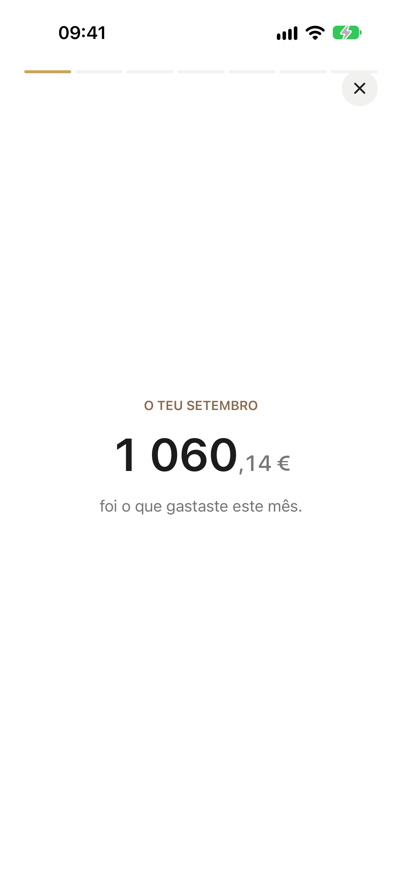
  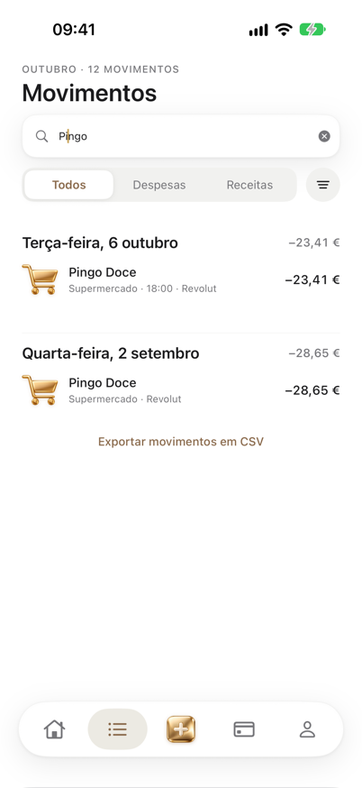
</p>

## Planear

<p align="center">
  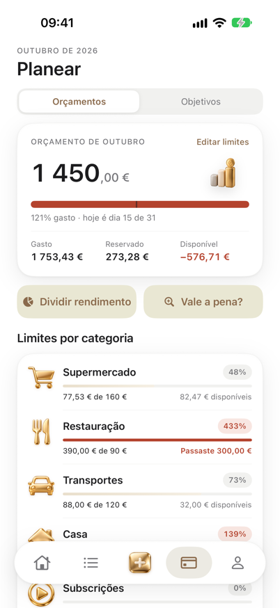
  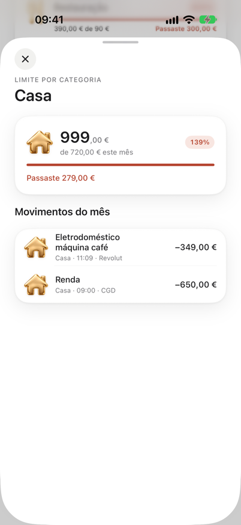
  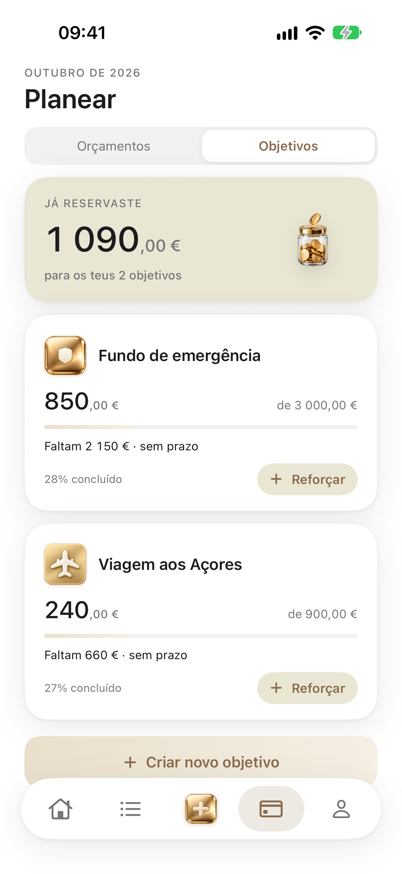
</p>

- **Orçamentos por categoria** — barras finas, douradas a partir de 90% do limite; toca numa categoria para ver os movimentos que a compõem.
- **Dividir rendimento** — ao receber dinheiro, divide-o pelas categorias e pela poupança num só gesto.
- **Objetivos** — metas de poupança com progresso, prazo e reforços.
- **Contas fixas e subscrições** — descontadas ao mês inteiro, nunca contadas duas vezes, com deteção de subidas de preço e sugestões de novas recorrentes.
- **Segunda opinião** — antes de comprar, a Lume procura o preço e diz quantos dias do teu ritmo essa compra consome.

<p align="center">
  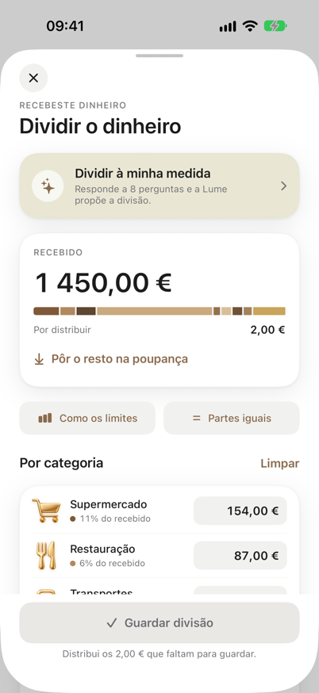
  
  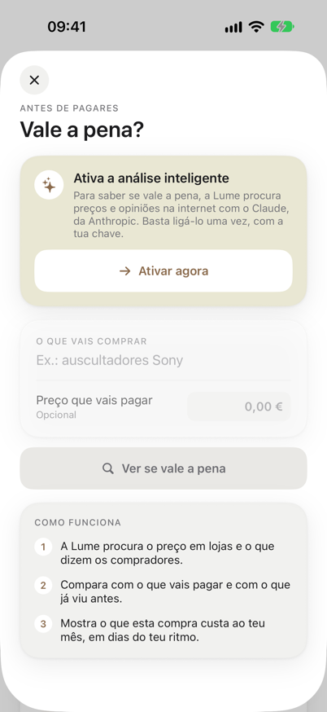
</p>

## Garantias e talões

Compras acima de um certo valor, nas categorias certas, pedem logo para guardar a garantia — com a foto do talão e um lembrete antes do prazo acabar.

<p align="center">
  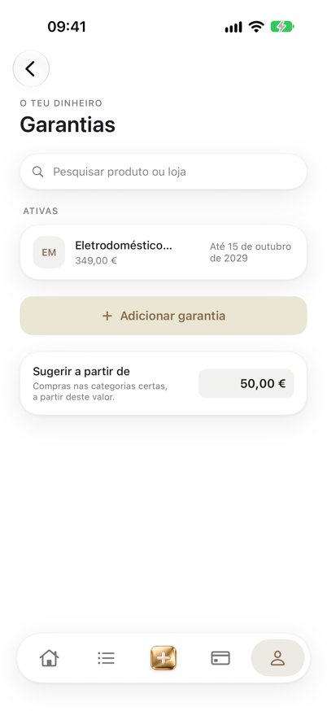
  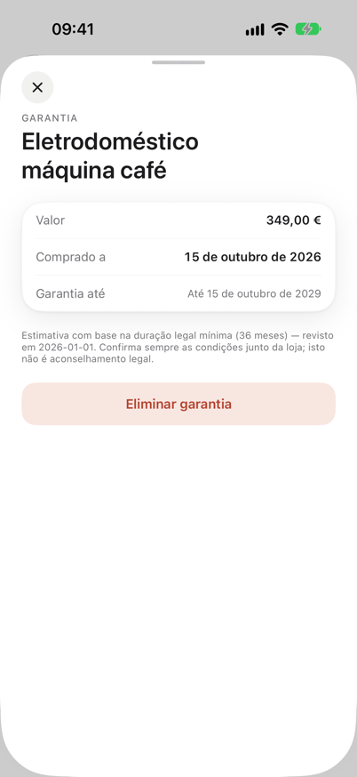
  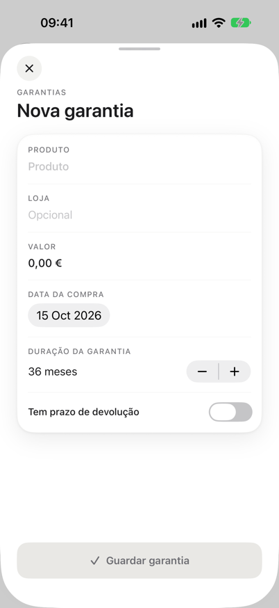
</p>

- Sugestão automática ao registar uma despesa grande, já preenchida com o produto, a loja e o valor.
- Lista ordenada pelas que acabam primeiro, com um aviso quando faltam 30 dias.
- Lembretes do fim da garantia e do prazo de devolução da loja.
- O valor mínimo que ativa a sugestão é configurável.

## Privacidade e bloqueio

<p align="center">
  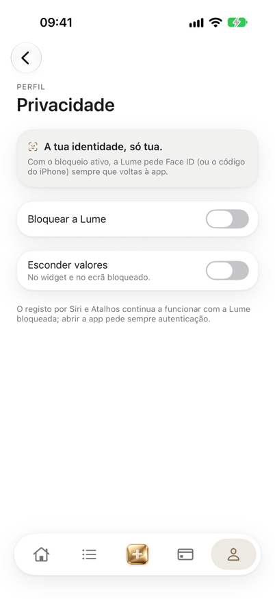
  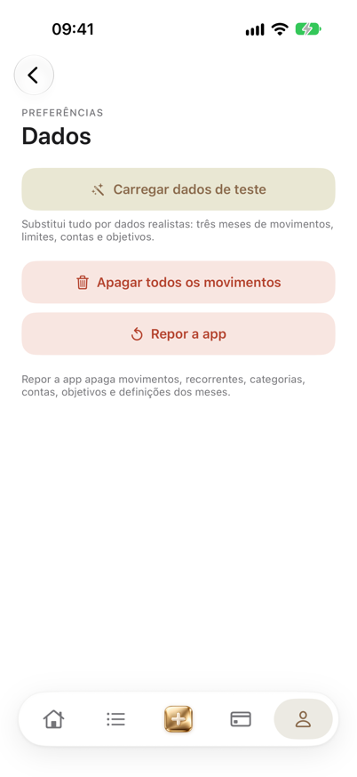
  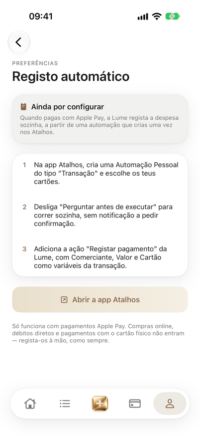
</p>

- **Face ID ou código de 4 dígitos** — a abrir a app, com um atraso configurável depois de ir para segundo plano.
- **Esconder valores** — no widget e no ecrã bloqueado.
- **Tudo local e no iCloud da pessoa** — a Lume não tem servidores nem faz analytics.

## Em todo o lado

<p align="center">
  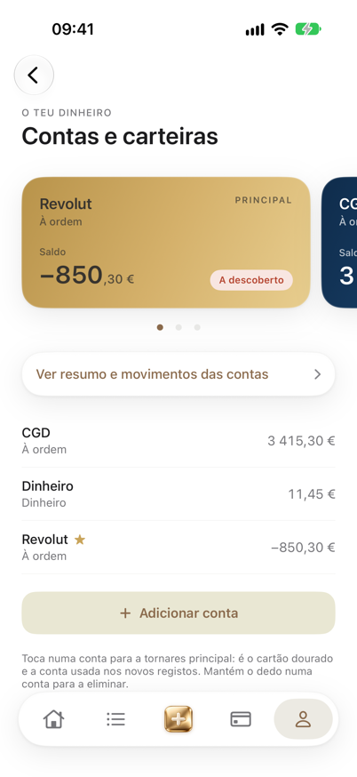
  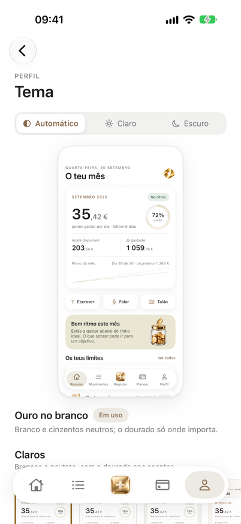
  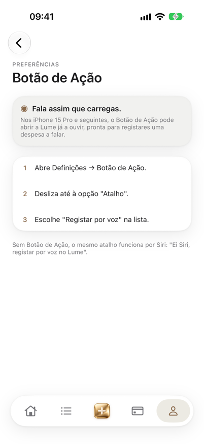
</p>

- **Widget** em três tamanhos e no ecrã bloqueado, com controlos de registo rápido.
- **Contas e carteiras** como cartões, com saldo calculado a partir dos movimentos e cor sugerida pelo banco.
- **Temas** — automático, claro ou escuro, com "ouro no branco" como assinatura visual.
- **Acessibilidade** — Dynamic Type, VoiceOver com frases completas, e respeito por "Reduzir movimento".
- **Inteligência artificial opcional** — Foundation Models no dispositivo por omissão; o Claude da Anthropic como alternativa Premium, com a chave guardada no Keychain.

---

## Arquitetura

```
Lume/
├── Modelos/        @Model SwiftData, compatíveis com CloudKit
├── Dominio/        lógica pura e nonisolated: calculadora do dia, garantias, fecho do mês, formatação
├── Interpretacao/  texto, voz e talão para dados estruturados, atrás de um protocolo
├── Dados/          contentor, dados de exemplo, Keychain, notificações, partilha com o widget
├── Interface/      SwiftUI, um separador por pasta, com o tema e os componentes partilhados
└── Intents/        App Intents para a Siri, os Atalhos e o registo automático por Apple Pay
LumeWidget/         WidgetKit
LumeTests/          Swift Testing
```

- **Domínio puro.** A `CalculadoraDoDia`, a `Garantias` e o `FechoDoMes` recebem valores e devolvem valores, sem SwiftUI nem SwiftData — é por isso que se testam facilmente.
- **Interpretação atrás de um protocolo.** O `InterpretadorDeDespesas` tem implementações com Foundation Models, com regras e com o Claude. A fábrica escolhe conforme a disponibilidade, e se uma falhar entra a seguinte.
- **Regras externas em JSON, não em código.** Coisas como a duração legal de uma garantia vivem em `RegrasDeGarantia.json`, com um valor de reserva se o ficheiro faltar — para nunca bloquear a app, e para serem fáceis de rever quando a lei mudar.
- **Nada de estado derivado guardado.** Saldos e totais são sempre calculados a partir dos movimentos.
- **Dinheiro em `Decimal`**, criado sempre a partir de texto e formatado em pt-PT: `1 092,90 €`.

## Testes

101 testes com Swift Testing, num calendário fixo em `Europe/Lisbon`. Cobrem o início e o fim do mês, meses de 28, 30 e 31 dias, dias sem gastos, gastos acima do limite, recorrentes que não podem contar duas vezes, garantias perto do fim e já expiradas, a interpretação de frases, a leitura de talões e o mapeamento das respostas dos modelos.

```
⌘U no Xcode
```

## Correr o projeto

Abre `Lume.xcodeproj` no Xcode 27 e corre no simulador do iPhone 18 Pro. Em DEBUG, uma base vazia é preenchida com dados de exemplo portugueses. No simulador não há Apple Intelligence nem Face ID por omissão, por isso a interpretação usa a alternativa por regras e o bloqueio pode ser testado com o menu **Features → Face ID** do simulador.
